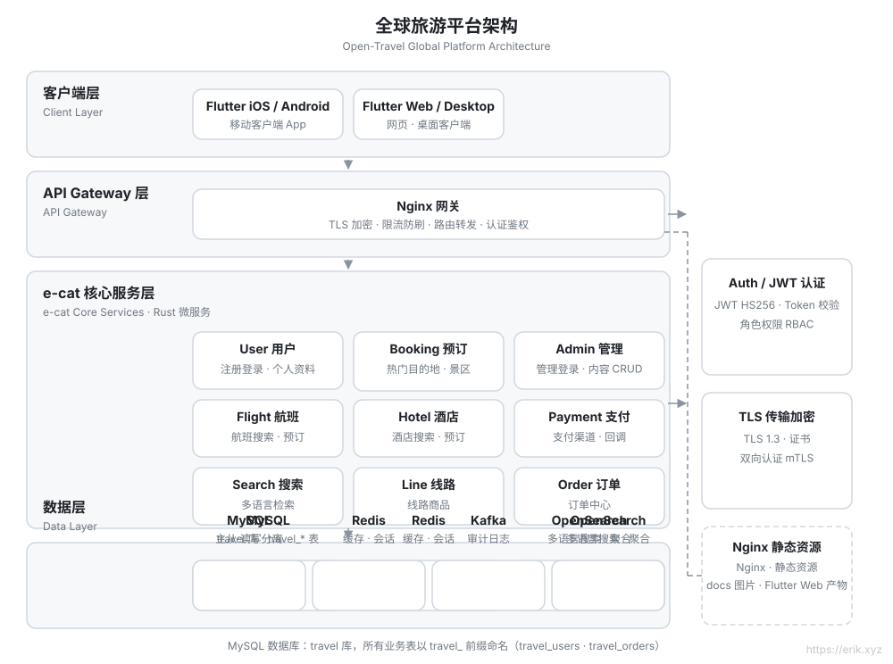
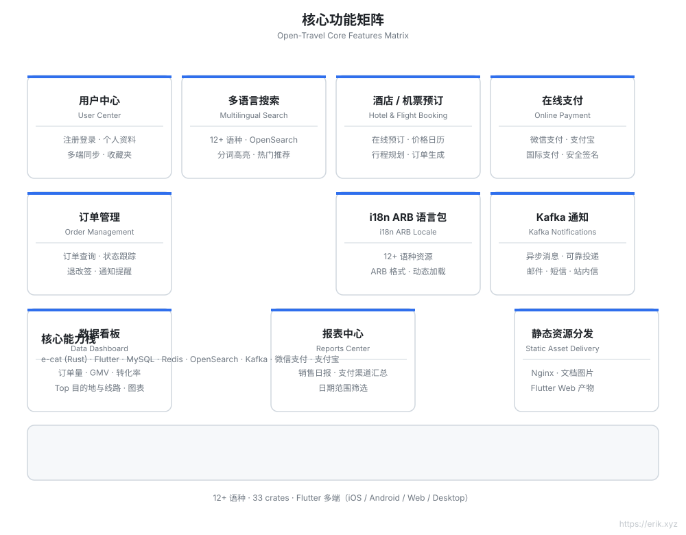
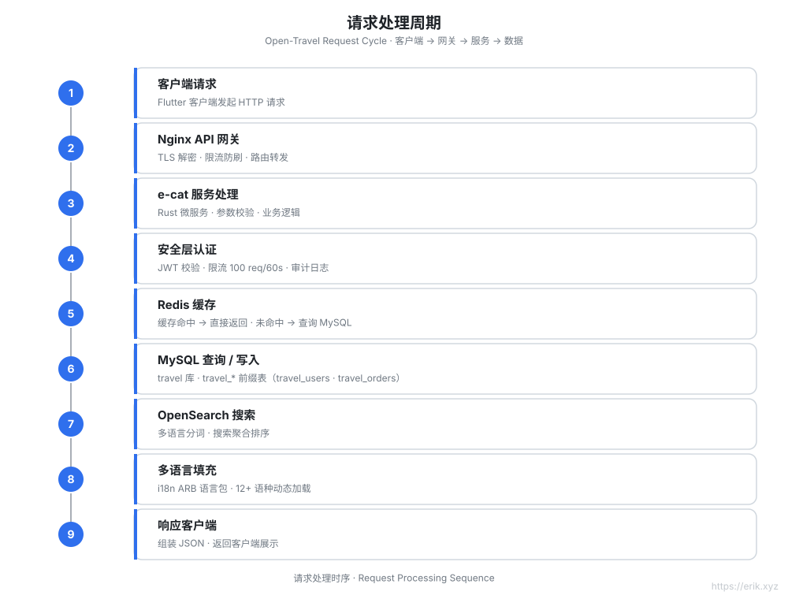
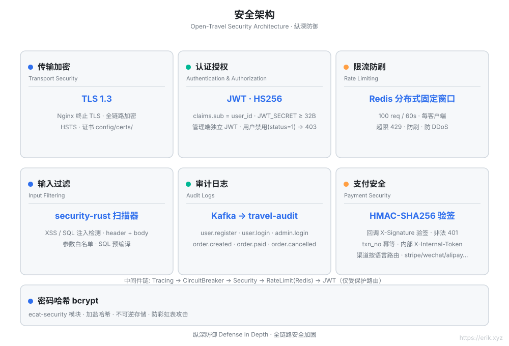
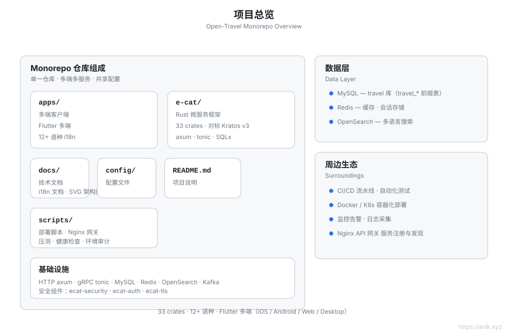

# Open Travel — 全球旅游平台

<p align="center"></p>
<p align="center"><sub>罗盘精灵「南南」· 全原创矢量图形，扁平几何（无渐变 / 无第三方素材）</sub></p>

[English](docs/i18n/en/README.md)

> 一个面向全球用户的旅游预订平台：Rust 微服务后端 + Flutter 多端客户端，支持 **12+ 种语言**、国际支付与多语言搜索。

## 项目简介

Open Travel 是一个全球旅游平台 monorepo，采用 **e-cat（一只猫）** —— 对标 [go-kratos/kratos](https://github.com/go-kratos/kratos) v3 的 **Rust 微服务框架**（v3.0.3 · 33 crates）—— 构建高性能后端，配合 Flutter 多端客户端，为全球用户提供统一的旅行预订体验。

| 维度 | 说明 |
| :--- | :--- |
| **后端框架** | e-cat（Rust）：HTTP/axum + gRPC/tonic，33 crates 微服务生态 |
| **多端客户端** | `apps/client/flutter`（iOS / Android / Web / Desktop）、`apps/admin`（Flutter Web 管理端） |
| **数据库** | MySQL（库名 `travel`，表前缀 `travel_`）+ Redis 缓存 + OpenSearch 多语言搜索 |
| **安全** | ecat-security / ecat-auth（JWT）/ ecat-tls：认证、审计、限流、防注入 |
| **国际化** | 12+ 语种 ARB 语言包，RTL 支持，OpenSearch 多语言分词 |
| **支付** | 微信支付、支付宝 |

## 项目吉祥物「南南」

一只罗盘精灵：圆表盘就是身体，表圈上 **12 个刻度 = 12+ 语种**，头顶立着一根指针，右手举放大镜找目的地，左上角一架纸飞机拉着航线。扁平几何造型（纯色块 + 细描边，无渐变、无半透明），矢量源与完整设定见 [`docs/mascot.svg`](docs/mascot.svg)。

| 落点 | 形式 |
| :--- | :--- |
| `docs/mascot.svg` | **矢量唯一源**（全身像 512×512） |
| `apps/*/web/favicon.svg` | 浏览器标签图标（表盘特写版，16px 下仍可辨认；`favicon.png` 16px 兜底旧浏览器） |
| `apps/*/web/icons/Icon-*.png` | PWA / 主屏图标 192·512（含 maskable 安全区版） |
| `apps/*/assets/mascot.png` | Flutter 应用内展示（管理端登录页、客户端个人页） |
| 各 README / crate 文档 | 页首品牌位 |

> 改造型只改 `docs/mascot.svg`，其余均为派生件：favicon 是它的表盘特写（去掉手臂 / 放大镜 / 脚 / 航线等小尺寸糊掉的笔画），应用内图标由同一矢量源导出。全部图形为原创，无第三方素材依赖。


<!-- pet-expressions:start -->
## 项目宠物表情形态 · 南南

<table align="center">
<tr><td align="center"><br><b>笑</b><br><code>:emoji-smile:</code></td><td align="center"><br><b>欢乐</b><br><code>:emoji-joy:</code></td><td align="center"><br><b>哭</b><br><code>:emoji-cry:</code></td><td align="center"><br><b>沮丧</b><br><code>:emoji-depressed:</code></td><td align="center"><br><b>惊恐</b><br><code>:emoji-terrified:</code></td><td align="center"><br><b>愤怒</b><br><code>:emoji-angry:</code></td></tr>
<tr><td align="center"><br><b>撒娇</b><br><code>:emoji-coquettish:</code></td><td align="center"><br><b>卖萌</b><br><code>:emoji-cute:</code></td><td align="center"><br><b>讨好</b><br><code>:emoji-pleasing:</code></td><td align="center"><br><b>敲打</b><br><code>:emoji-knocking:</code></td><td align="center"><br><b>捂脸</b><br><code>:emoji-facepalm:</code></td><td align="center"><br><b>吐舌头</b><br><code>:emoji-tongue:</code></td></tr>
</table>

> 12 种彩色动态形态：笑 / 欢乐 / 哭 / 沮丧 / 惊恐 / 愤怒 / 撒娇 / 卖萌 / 讨好 / 敲打 / 捂脸 / 吐舌头。每个 SVG 自带表情、情绪特效与整体动效，并遵循 `prefers-reduced-motion`。
<!-- pet-expressions:end -->

<!-- assets-license:start -->
## 视觉资产授权 / Visual Assets License

本项目的项目宠物、图片、图标、表情（包括 `docs/pet-expressions/` 等目录下的
SVG / PNG）**不是开源资产**，版权归作者所有。未经书面许可不得复制、修改、再分发或
用于商业用途；商业使用需取得商业授权，联系 **erik@erik.xyz**。详见
[ASSETS-LICENSE.md](ASSETS-LICENSE.md)。

> 代码部分仍遵循仓库原有 `LICENSE`；第三方素材（如明确标注的 Go Gopher 等）仍遵循其原许可证。
<!-- assets-license:end -->


## 一键安装

环境要求：Docker + Docker Compose（v2）。（Rust 工具链仅源码构建需要）

```bash
git clone <仓库地址> && cd open-travel
./scripts/install.sh
```

脚本自动：检查环境 → 构建并启动全部服务（MySQL/Redis/OpenSearch/Kafka/9 个微服务/Nginx 网关）→ 初始化搜索索引 → 健康巡检，完成后打印访问地址与默认管理账号。

> 使用说明：访问 http://localhost:8082/health 探活；管理端登录 `admin@travel.local` / `Admin@123`；客户端（`apps/client/flutter`）用 `flutter run -d chrome` 启动。

## 快速开始

> 以下使用说明聚焦后端（Rust 微服务）；客户端（apps/）构建方式见各子目录。

### 环境要求

- Rust 1.85+（stable 工具链，edition 2024）
- Docker + Docker Compose

### 构建与启动

```bash
cd e-cat
cargo check -p ecat --bin user-service --bin booking-service --bin admin-service \
  --bin search-service --bin line-service --bin order-service --bin flight-service \
  --bin hotel-service --bin payment-service   # 编译检查业务服务

docker compose -f config/docker-compose.yml up -d   # 启动数据源 + 服务 + 网关
```

> 不要使用 `--env-file .env` 启动（会报错）。

### 端口

| 服务 | 端口 | 说明 |
|------|------|------|
| user-service | 8001 | 用户注册 / 登录 / 资料 |
| booking-service | 8002 | 热门目的地日期 + 景区列表/详情 |
| admin-service | 8003 | 管理端：登录 + 目的地/景区 CRUD |
| search-service | 8004 | 多语种搜索 |
| line-service | 8005 | 旅游线路 |
| order-service | 8006 | 订单 |
| flight-service | 8007 | 机票 |
| hotel-service | 8008 | 酒店 |
| payment-service | 8009 | 支付 |
| Nginx 网关 | 8082→80 | 按 `/api/v1/user/`、`/api/v1/booking/`、`/api/v1/admin/`、`/api/v1/search`、`/api/v1/lines`、`/api/v1/orders`、`/api/v1/flights`、`/api/v1/hotels`、`/api/v1/payments` 前缀分流 |
| MySQL | 3308→3306 | 数据源（宿主端口冲突，临时映射） |
| Redis | 6381→6379 | 缓存 / 限流 |
| OpenSearch | 9201→9200 | 多语言搜索 |

### 验证

> 业务接口版本在 URL 前缀：`/api/v1/...`（无需版本请求头）。

```bash
curl http://localhost:8082/health
curl "http://localhost:8082/api/v1/booking/dates?region_id=1"
# {"code":0,"message":"ok","data":[]}

# 管理端登录（admin@travel.local / Admin@123 为开发环境默认账号，仅本地使用）
curl -X POST http://localhost:8082/api/v1/admin/login -H "Content-Type: application/json" \
  -d '{"email":"admin@travel.local","password":"Admin@123"}'
# {"code":0,"message":"ok","data":{"token":"<jwt>"}}

# 景区列表（按目的地查询，多语种字段按 lang 返回）
curl "http://localhost:8082/api/v1/booking/attractions?destination_id=1"
# {"code":0,"message":"ok","data":[{...}]}
```

### 脚本

| 脚本 | 用途 |
|------|------|
| `scripts/install.sh` | 一键安装：环境检查 → 启动全部服务 → 初始化搜索索引 → 健康巡检 → 打印访问地址与账号（幂等，可重复执行） |
| `scripts/up.sh` / `down.sh` | 启动 / 停止 compose 全部服务 |
| `scripts/deploy.sh` | 重新构建并重启服务 |
| `scripts/health_check.sh` | 服务健康巡检 |
| `scripts/opensearch_init.sh` | 幂等创建 OpenSearch 索引（cjk 分析器） |
| `scripts/loadtest.sh` | 压测 |
| `scripts/reconcile_payments.sh` | 支付订单对账 |
| `scripts/env_audit.sh` | 环境变量与配置审计 |

### 后端文档

- 后端 README（含中间件链、环境变量、版本发布流程）：[e-cat/README.md](e-cat/README.md)
- API 参考（端点、鉴权、限流）：[docs/api.md](docs/api.md)

## 核心特性

- 🏨 目的地 / 酒店 / 机票多语言搜索与预订
- 🌍 12+ 语种独立适配（中、英、日、韩、阿、西、法、德……）
- 💳 国际支付（微信支付 / 支付宝）
- 🔐 安全纵深：TLS 1.3、JWT 认证、审计日志、输入过滤、限流、支付回调 HMAC 验签与内部服务鉴权
- 📱 多端一致体验：Flutter（iOS/Android/Web/Desktop）

## 架构设计图



## 功能设计图



## 请求生命周期图



## 安全架构图



> 分层防护：Tracing → CircuitBreaker → Security → RateLimit(Redis，100 req/60s) → JWT（仅受保护路由）；API 版本在 URL 前缀 `/api/v1/`，未知版本由网关 404；支付回调 HMAC 验签 + 内部 X-Internal-Token 鉴权。

## 项目结构图



> 图表英文版位于 `docs/svg/en/`。

## 项目结构

```
open-travel/
├── apps/                  # 多端客户端与管理端
│   ├── client/
│   │   └── flutter/       # Flutter：iOS / Android / Web / Desktop（12+ 语种 i18n，web/favicon.svg 为「南南」图标）
│   └── admin/             # Flutter Web 管理端
├── e-cat/                 # e-cat 框架 + 业务服务（同一 Cargo workspace）
│   ├── ecat*/             # 33 个 ecat-* 框架 crate
│   ├── ecat/              # 主框架 crate：门面 + 业务模块（src/business/）+ 服务入口（src/bin/ 9 个服务）
│   ├── config/            # 框架配置示例
│   ├── examples/          # 框架示例项目
│   └── CHANGELOG.md       # 框架 + 项目版本变更日志（版本号即项目版本，见 tags）
├── docs/                  # 技术文档
│   ├── api.md             # API 参考（端点、鉴权、限流）
│   ├── integration-report.md # 联调报告
│   ├── loadtest-report.md    # 压测报告
│   ├── mascot.svg         # 吉祥物「南南」（矢量唯一源，favicon 与各端图标由此派生）
│   ├── svg/               # 架构 / 功能 / 生命周期 / 安全 / 结构 图（英文版见 svg/en/）
│   └── i18n/              # 英文 README（en/）
├── config/                # 环境与部署配置（nginx.conf、docker-compose.yml、schema.sql）
├── scripts/               # 安装 / 部署 / 巡检 / 压测
├── .github/workflows/     # CI
└── README.md
```

## 数据库

- 数据库名：`travel`
- 表前缀：`travel_`（例如 `travel_users`、`travel_orders`、`travel_bookings`）
- 配套存储：Redis（会话 / 热门缓存）、OpenSearch（多语言搜索索引）

---

## 支持我们

如果这个项目对你有帮助，欢迎请作者喝一杯咖啡 ☕

<p align="center">
  <strong>微信支付（WeChat Pay）</strong> &nbsp;&nbsp;&nbsp;&nbsp;&nbsp;&nbsp;&nbsp;&nbsp;&nbsp;&nbsp;&nbsp;&nbsp;&nbsp;&nbsp;&nbsp;&nbsp;&nbsp;&nbsp; <strong>支付宝（Alipay）</strong><br/>
  
  &nbsp;&nbsp;&nbsp;&nbsp;&nbsp;&nbsp;&nbsp;&nbsp;
  
</p>


## 开源版 vs 商业版

> 本仓库是开源版，面向个人学习与研究；`open-project/open-travel` 对应商业版，面向商业部署与交付。商业版授权与交付条款请联系 **erik@erik.xyz**。

| 维度 | 开源版（本仓库） | 商业版 |
|---|---:|---:|
| 定位 | 核心旅游预订平台，个人学习/研究 | 完整商业交付，含扩展客户端与运维控制台 |
| e-cat crate | 33 | 54 |
| Rust 微服务 | 9 | 9 |
| 后端 API 路径 | 59 | 64 |
| 后端路由注册 | 80 | 86 |
| 后端异步 handler | 156 | 165 |
| 源码文件 / 行数 | 162 / 36,778 | 220 / 50,926 |
| 数据表 | 15 | 16 |
| Flutter 客户端页面 | 12 | 12 |
| Flutter 管理端页面 | 17 | 18 |
| HarmonyOS 客户端 | — | 20 个 ArkTS 页面 |
| CDN 管理控制台 | — | 有（4 个后台接口 + 管理页 + 8 云厂商脚本） |
| 评论后端 | — | 有（`/api/v1/reviews`） |
| 演示种子数据 | — | 3 个 SQL（景点/线路/Phase4） |

**商业版额外提供**

- 21 个扩展 e-cat crate：ArangoDB / ClickHouse / Elasticsearch / InfluxDB / IoTDB / Memcached / MongoDB / NebulaGraph / Neo4j / QuestDB / S3 / TDengine 数据后端，MQTT / NATS / RabbitMQ 消息队列，etcd 注册中心，GraphQL、OpenAPI、调度器、版本化与压测模块。
- HarmonyOS ArkTS 原生客户端（20 页）。
- CDN 控制台：供应商配置、状态/方案、管理端页面与 `cdn_setup.sh` / `cdn_upload.sh` 八云厂商脚本。
- 评论后端：`/api/v1/reviews` 与景点详情评论聚合。
- 景点/线路/Phase4 演示种子数据。

**开源版保留**

- 9 个 Rust 微服务（user / booking / flight / hotel / line / order / payment / search / admin）、Flutter 客户端与 Flutter 管理端。
- 核心预订、订单、支付、搜索、用户、库存与后台管理链路，33 个 e-cat 核心 crate。
- 与商业版相同的项目授权条款（个人学习/研究；商业使用需授权）。

**English:** This repository is the open-source edition for personal study and research. The commercial edition in `open-project/open-travel` adds 21 e-cat crates, a HarmonyOS client, a CDN console, a reviews backend and demo seed data. For commercial licensing and delivery terms, contact **erik@erik.xyz**.

## 项目授权 / Project License

Copyright (c) 2026 erik <erik@erik.xyz> — https://erik.xyz

- 本项目仅供个人学习、研究使用。
- 未经作者书面授权，禁止任何形式的商业使用（包括但不限于商业部署、付费服务、二次销售、SaaS 运营及以本项目为基础提供商业服务）。
- 商业授权请联系 **erik@erik.xyz**。
- 未经授权的商业使用，作者将在全球范围内依法追究法律责任，并保留终身追责的权利。
- 第三方组件仍遵循其各自原有的许可证；视觉资产适用仓库内的 ASSETS-LICENSE.md（如适用）。

**English:** This project is provided for personal study and research only. Commercial use of any kind requires prior written authorization from the author (erik@erik.xyz). Unauthorized commercial use will be pursued for legal liability worldwide, and the author reserves the right to pursue such liability for life. Third-party components remain under their original licenses; visual assets are governed by ASSETS-LICENSE.md where applicable.
