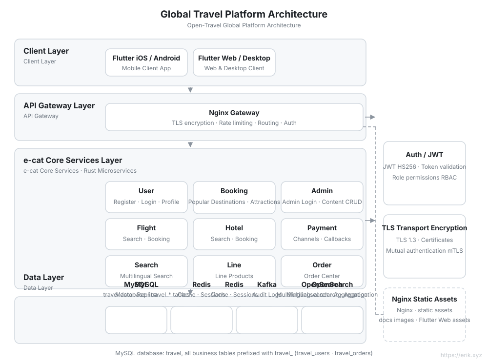
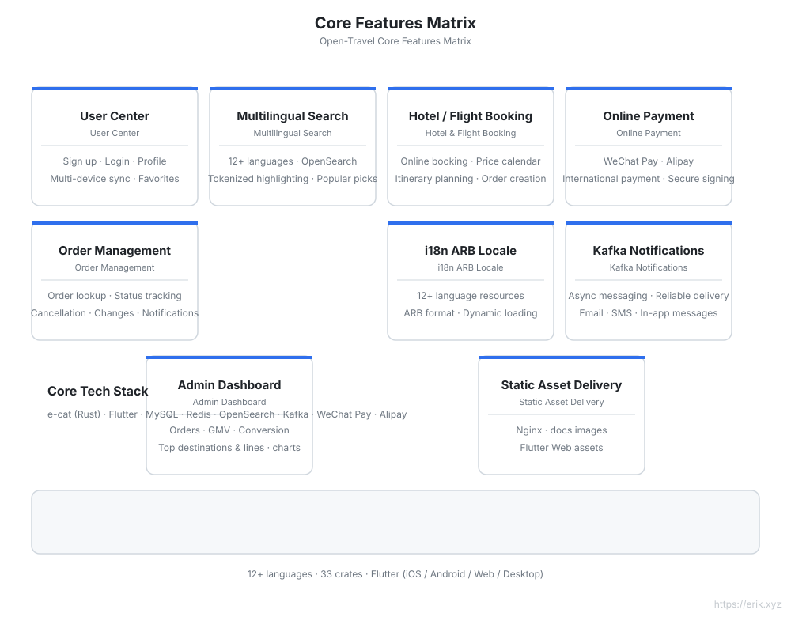
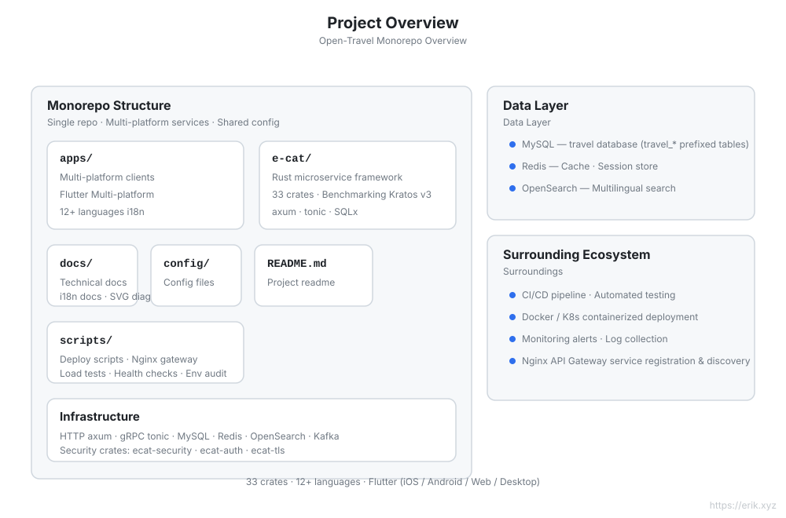
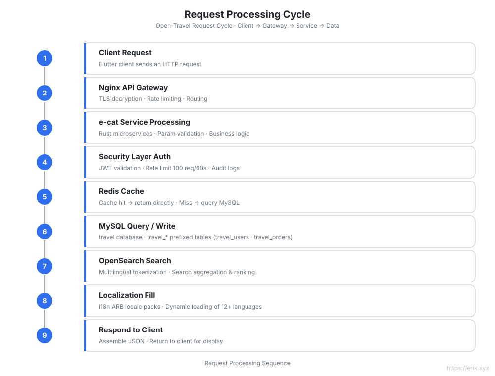
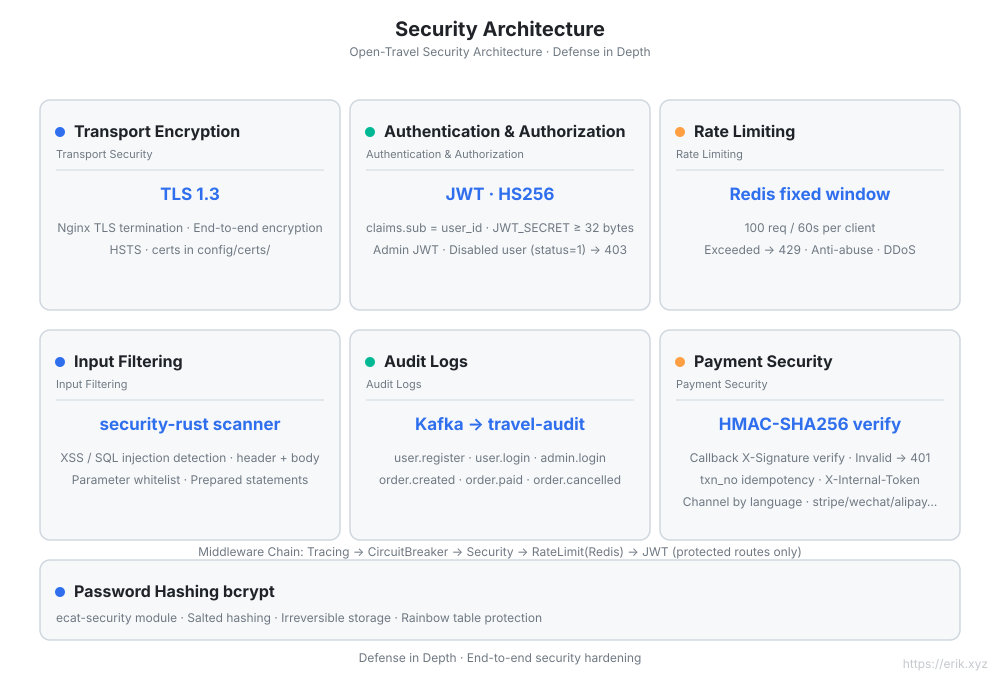

[简体中文](../../../README.md) | English

# Open Travel — Global Travel Platform


> A travel booking platform for users worldwide: Rust microservice backend + Flutter multi-platform clients, supporting **12+ languages**, international payments, and multilingual search.

## Introduction

Open Travel is a global travel platform monorepo built on **e-cat (a cat)** — a **Rust microservice framework** (v3.0.3 · 33 crates) modeled after [go-kratos/kratos](https://github.com/go-kratos/kratos) v3 — delivering a high-performance backend, paired with Flutter multi-platform clients, to offer a unified travel booking experience to users around the globe.

| Dimension | Description |
| :--- | :--- |
| **Backend framework** | e-cat (Rust): HTTP/axum + gRPC/tonic, a 33-crate microservice ecosystem |
| **Multi-platform clients** | `apps/client/flutter` (iOS / Android / Web / Desktop), `apps/admin` (Flutter Web admin console) |
| **Database** | MySQL (database `travel`, table prefix `travel_`) + Redis cache + OpenSearch multilingual search |
| **Security** | ecat-security / ecat-auth (JWT) / ecat-tls: authentication, audit, rate limiting, injection prevention |
| **Internationalization** | 12+ language ARB locale packs, RTL support, OpenSearch multilingual tokenization |
| **Payments** | WeChat Pay, Alipay |

## Project Mascot "Nannan 南南"

A compass sprite: the round dial is its body, the bezel carries **12 tick marks = 12+ languages**, a needle stands on top of its head, the right hand holds a magnifier hunting for destinations, and a paper plane trails a flight path in the upper left. Flat geometric styling (solid color blocks + thin outlines, no gradients, no transparency); see [`docs/mascot.svg`](../../mascot.svg) for the vector source and the full design.

| Placement | Form |
| :--- | :--- |
| `docs/mascot.svg` | **Single vector source** (full body, 512×512) |
| `apps/*/web/favicon.svg` | Browser tab icon (dial close-up, still legible at 16px; `favicon.png` 16px fallback for old browsers) |
| `apps/*/web/icons/Icon-*.png` | PWA / home screen icons 192·512 (including maskable safe-zone variants) |
| `apps/*/assets/mascot.png` | In-app display in Flutter (admin login page, client profile page) |
| Each README / crate doc | Header branding slot |

> To restyle the mascot, edit only `docs/mascot.svg` — everything else is derived: the favicon is a close-up of its dial (dropping the arms / magnifier / feet / flight path and other strokes that blur at small sizes), and mobile raster variants are derived from the same vector source. All artwork is original, with no third-party asset dependencies.

## Key Features

- 🏨 Multilingual search and booking for destinations / hotels / flights
- 🌍 12+ languages independently adapted (Chinese, English, Japanese, Korean, Arabic, Spanish, French, German…)
- 💳 International payments (WeChat Pay / Alipay)
- 🔐 Defense in depth: TLS 1.3, JWT authentication, audit logs, input filtering, rate limiting, payment callback HMAC verification, internal service auth
- 📱 Consistent experience across platforms: Flutter (iOS/Android/Web/Desktop)

## Architecture Design Diagram



## Feature Design Diagram



## Project Structure Diagram



## Request Lifecycle Diagram



## Security Architecture Diagram



## Project Structure

```
open-travel/
├── apps/                  # Multi-platform clients and admin console
│   ├── client/
│   │   ├── flutter/       # Flutter: iOS / Android / Web / Desktop (12+ language i18n; web/favicon.svg is the "Nannan 南南" icon)
│   └── admin/             # Flutter Web admin console
├── e-cat/                 # e-cat framework + business services (single Cargo workspace)
│   ├── ecat*/             # 33 ecat-* framework crates
│   ├── ecat/              # Main framework crate: facade + business modules (src/business/) + service entries (src/bin/, 9 services)
│   ├── config/            # Framework config examples
│   ├── examples/          # Framework example projects
│   └── CHANGELOG.md       # Framework changelog (project versions: root CHANGELOG.md + tags)
├── docs/                  # Technical documentation
│   ├── api.md             # API reference (endpoints, auth, rate limiting)
│   ├── mascot.svg         # Mascot "Nannan 南南" (single vector source; favicon and per-platform icons are derived from it)
│   ├── svg/               # Architecture / feature / lifecycle / security / structure diagrams (English versions in svg/en/)
│   ├── i18n/              # English README
├── config/                # Environment and deployment config (nginx.conf, docker-compose.yml, schema.sql)
├── scripts/               # Install / deploy / health check / load test / payment reconciliation
├── .github/workflows/     # CI
└── README.md
```

## Database

- Database name: `travel`
- Table prefix: `travel_` (e.g. `travel_users`, `travel_orders`, `travel_attractions`)
- Companion storage: Redis (sessions / hot caches), OpenSearch (multilingual search index)

## One-Click Install

Requirements: Docker + Docker Compose (v2). (The Rust toolchain is only needed when building from source.)

```bash
git clone <repo-url> && cd open-travel
./scripts/install.sh
```

The script automatically: checks the environment → builds and starts all services (MySQL / Redis / OpenSearch / Kafka / 9 microservices / Nginx gateway) → initializes search indexes → runs a health check, then prints the access URL and default admin account `admin@travel.local` / `Admin@123`.

## Quick Start

```bash
cd e-cat
cargo check -p ecat --bins   # compile check for business services
```

| Service | Port | Description |
|---|---|---|
| user-service | 8001 | User registration / login / profile |
| booking-service | 8002 | Popular destination dates + attraction list / detail |
| admin-service | 8003 | Admin: login + destination / attraction CRUD |
| search-service | 8004 | Multilingual search |
| line-service | 8005 | Travel lines |
| order-service | 8006 | Orders |
| flight-service | 8007 | Flights |
| hotel-service | 8008 | Hotels |
| payment-service | 8009 | Payments |
| Nginx gateway | 8082→80 | Routes `/api/v1/user/`, `/api/v1/booking/`, `/api/v1/admin/`, `/api/v1/search`, `/api/v1/lines`, `/api/v1/orders`, `/api/v1/flights`, `/api/v1/hotels`, `/api/v1/payments` prefixes |
| MySQL | 3308→3306 | Data source |
| Redis | 6381→6379 | Cache / rate limiting |
| OpenSearch | 9201→9200 | Multilingual search |

The admin Flutter Web console lives in `apps/admin/`; the development default admin account is `admin@travel.local` / `Admin@123` (local use only).

### Scripts

| Script | Description |
|---|---|
| `scripts/install.sh` | One-click install: environment check → start all services → init search indexes → health check → print URLs and default account (idempotent) |
| `scripts/up.sh` / `down.sh` | Start / stop the compose stack |
| `scripts/deploy.sh` | Rebuild and restart services |
| `scripts/health_check.sh` | Service health check |
| `scripts/opensearch_init.sh` | Idempotently creates the OpenSearch index (cjk analyzer) |
| `scripts/loadtest.sh` | Load testing |
| `scripts/reconcile_payments.sh` | Payment reconciliation |
| `scripts/env_audit.sh` | Environment variable and config audit |

---

## Support Us

If this project has helped you, feel free to buy the author a coffee ☕

**WeChat Pay**  **Alipay**

| WeChat Pay | Alipay |
|---|---|
|  |  |
